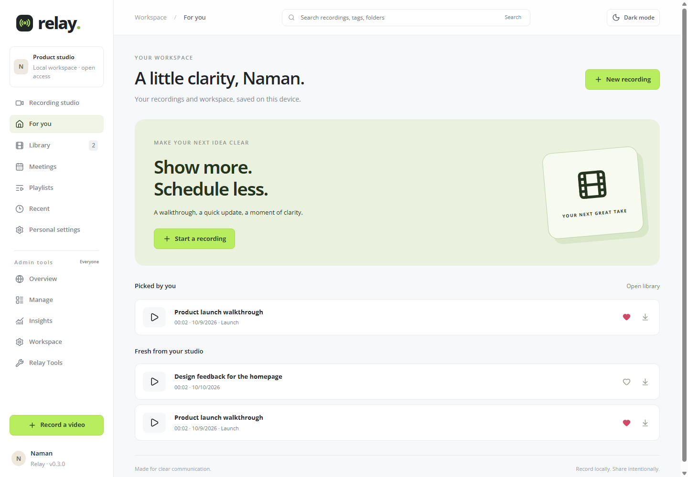
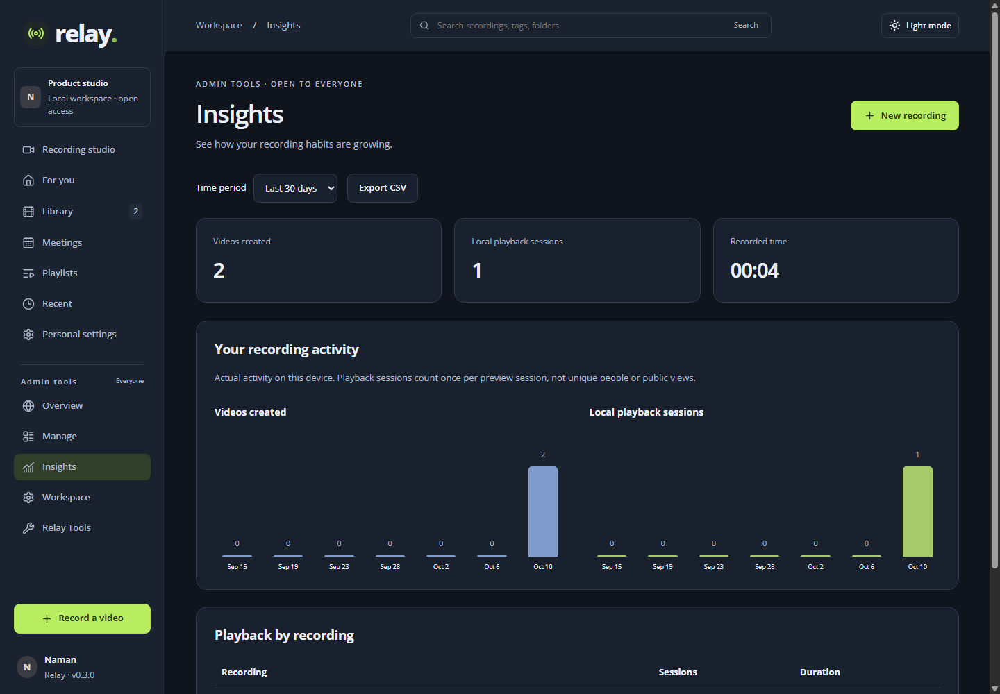

# Relay 0.3.0

A Chrome extension for recording a screen, camera, and microphone, with a local workspace for organizing and reviewing videos. No sign-in, roles, billing page, or cloud connection is required.

## Run the supplied extension

1. Open `chrome://extensions` in desktop Chrome (116 or newer).
2. Enable **Developer mode**, click **Load unpacked**, and select the `dist` folder.
3. Click Relay in the extensions menu. Choose **Recording studio**.
4. Enable the microphone and camera as desired. Click **Choose screen & record**, choose a source, and grant the device permissions Chrome requests.
5. Click **Finish recording**, preview the video, give it a title, and download a WebM copy.

For an existing installation at `E:\Projects\LOOM\dist`, click Reload on Relay's extension card, then reopen the studio. Keep using the same folder and Chrome profile to preserve access to your existing local library.

## Build from source

Use Node.js 22.12+ or 24 LTS and npm:

```sh
npm ci
npm run build
npm test
```

`npm run dev` opens a development server at `http://127.0.0.1:5173`. Load `dist` in Chrome for the final extension check. Formatting uses Biome, not Prettier.

## Working pages

| Page | Functionality |
| --- | --- |
| Recording studio | Screen/window/tab selection, optional microphone, camera composition, floating camera controls, countdown, pause/resume, preview, rename, download |
| For you | Favorite videos and recently created recordings |
| Library | Title/tag/folder search, sorting, folder filtering, favorites, playback, downloads, confirmed deletion |
| Meetings | Create/edit/delete agendas, date/time, link a saved video, export a 30-minute calendar event |
| Playlists | Create, rename, delete, add/remove and reorder videos, open videos |
| Recent | Recently recorded or recently played videos |
| Personal settings | Saved display name and light/dark appearance |
| Overview | Actual recording, playlist and storage totals |
| Manage | Edit titles/folders/tags, download, select and confirm bulk deletion |
| Insights | Date-filtered recording and local playback metrics, charts, CSV export |
| Workspace | Saved name and description, open-access explanation |
| Relay Tools | Storage estimate, workspace metadata export, privacy and product information |

All management pages are available to everyone using the same installation. Each Chrome profile has its own workspace; this is not a shared online team account. Meetings do not auto-join calls or send invitations. Atlassian Admin is replaced with Relay Tools; Billing is omitted.

## Data and privacy

Videos live in IndexedDB (`relay-recordings`). Workspace metadata and theme are stored locally. The extension has no cloud host permissions, no account credentials, and blocks network connections through its extension CSP. Camera and microphone are requested only through browser permission prompts.

Download important recordings. Clearing browser storage or removing the Chrome profile can remove the local library. Workspace metadata export does not include video files and is not a restorable full backup.

Playback metrics count once per preview session, not unique viewers or external shares. Up to the latest 10,000 playback sessions are retained. Deleted recordings are removed from local metrics and playlist references.

## Release scope

- Captions, translations, automatic audio uploads and sign-in were removed at the owner's request.
- AWS is not part of the runtime. The `backend` directory documents retirement of earlier cloud processing and retention of existing private data.
- No hard recording duration limit. Chunks accumulate in memory, so available RAM and browser storage constrain long recordings; crash recovery and multi-hour endurance are not guaranteed.
- Audio is microphone audio. System/tab audio, cloud sharing links, trimming, public viewer analytics, and cross-device sync are not implemented.
- A floating camera window may be included in an entire-screen capture in addition to the embedded overlay. Hide the floating window if needed; the composed camera remains in the recording.

See [SUBMISSION.md](SUBMISSION.md) for the approach and demo script, and [docs/testing.md](docs/testing.md) for verification and remaining hardware checks.

## Screenshots

Synthetic demonstration recordings are shown; new installations start with an empty library.




